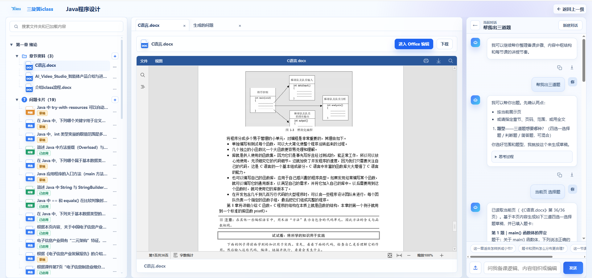
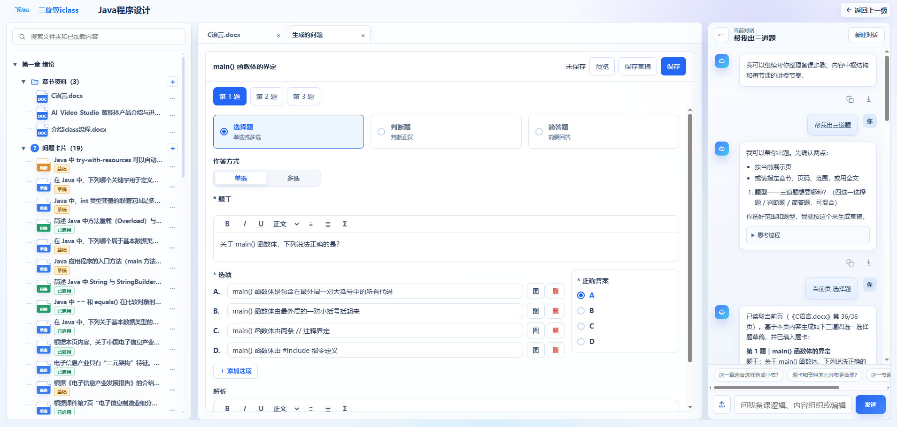
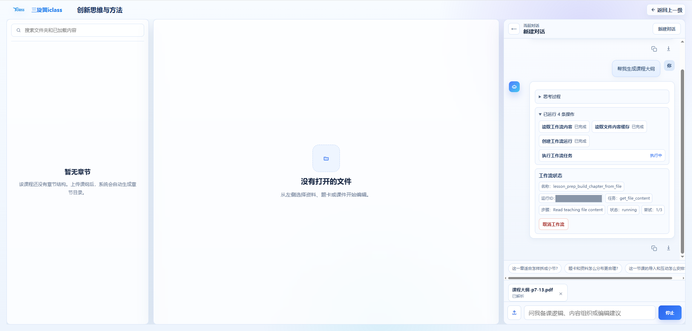
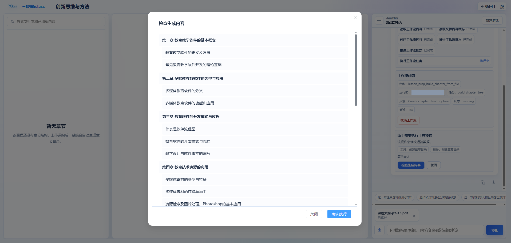
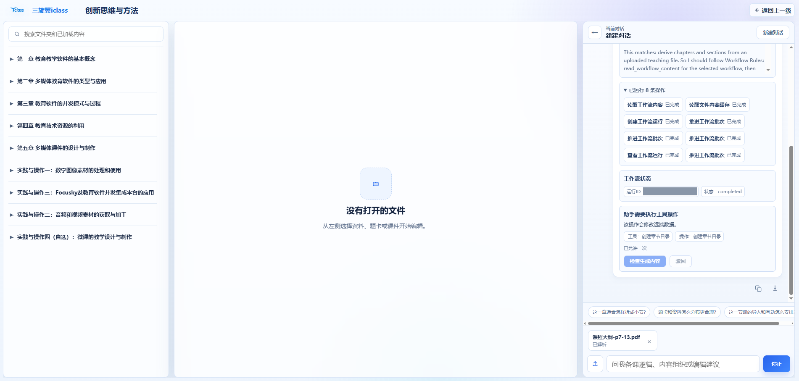
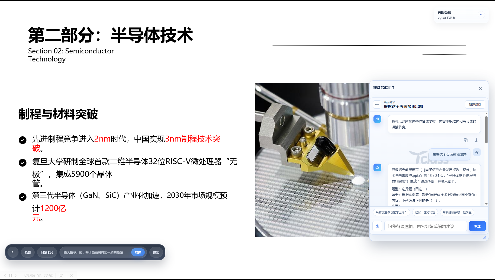
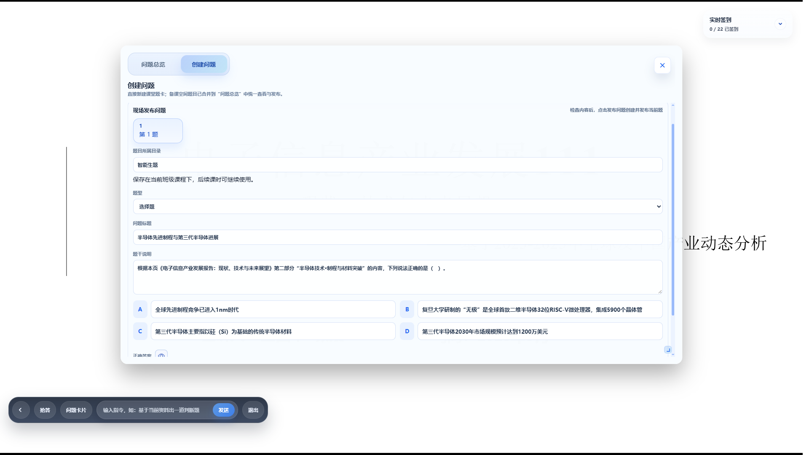
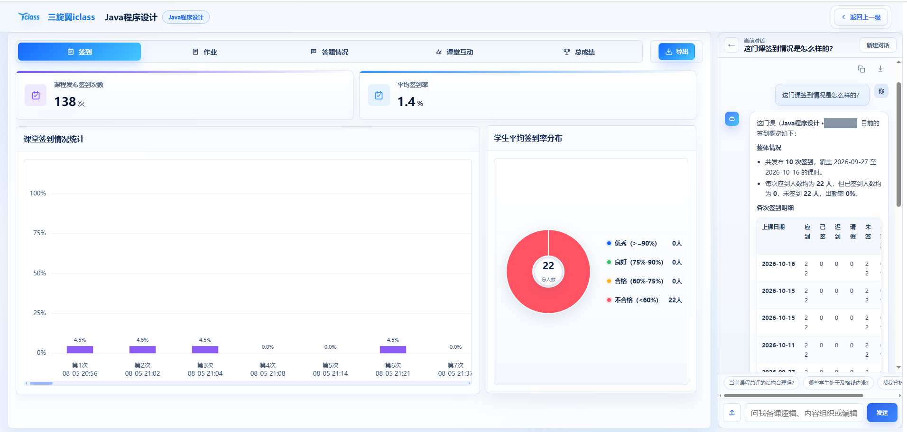
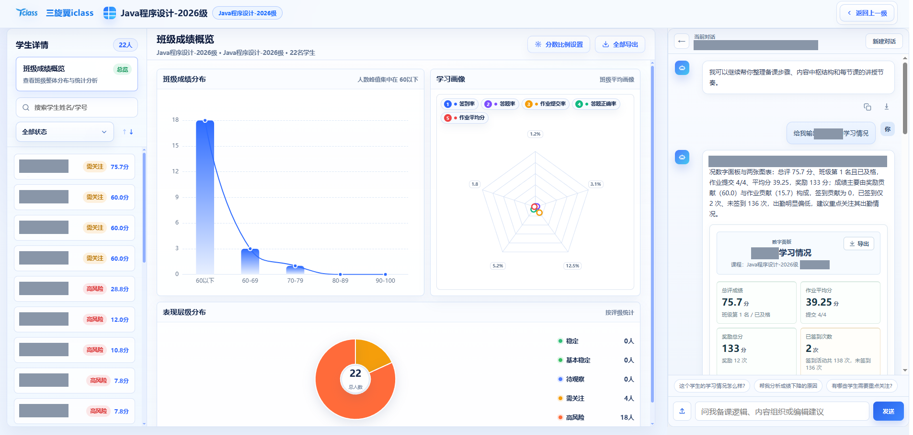

# class Agent

**面向教学场景的 Agent 服务与执行框架，连接课件、题卡、教学数据和课堂业务。**

class Agent 为教师提供自然语言驱动的备课、授课和教学分析能力：在全屏课件中围绕当前页现场出题，将生成结果交给可编辑题卡，读取课程行为数据生成学情分析与图表，并通过具有依赖关系的多 Agent 工作流执行复杂任务。

本仓库承担 Agent harness 职责；完整交互由 **class-web** 提供，教学业务接口与持久化由 **class-api** 提供。下文依据实际代码说明能力。本开源副本不包含真实部署地址、运行凭据和业务运行数据。

## 整体架构：三个项目如何协作

完整的 class 交互由三个项目共同完成：**class-web 负责页面与教师操作，class-agent 负责理解任务和编排执行，class-api 负责教学业务与持久化**。Agent 不是脱离业务页面的独立聊天窗口，而是在当前课程、资料和课堂上下文中工作。

~~~mermaid
flowchart LR
    W["class-web 备课空间、课堂空间、数据面板"]
    A["class-agent 模型循环、Skill、工具、工作流"]
    J["class-api 鉴权、教学业务、数据持久化"]
    L["模型服务"]
    R["知识检索与文件处理"]
    W -->|消息、页面上下文与当前页快照| A
    A -->|SSE 回复、题卡、图表与执行状态| W
    W <-->|教师操作对应的业务 API| J
    A <-->|已授权的业务工具调用| J
    A <--> L
    A <--> R
~~~

| 项目 | 负责什么 | 交接给下一层的内容 |
| --- | --- | --- |
| class-web | 展示课件和业务数据，采集当前页面上下文，渲染题卡、图表和确认界面 | 向 Agent 发送教师要求与页面上下文；教师保存、发布时调用业务 API |
| class-agent | 组织上下文，按 Skill 调用模型与工具，调度工作流，处理执行权限 | 向前端返回可消费的结构化结果；需要业务读写时调用授权工具 |
| class-api | 校验登录身份及业务访问权限，提供课程、资料、题目、课堂互动和学情数据接口 | 返回业务记录；保存题目、创建目录、发布课堂问题等操作的结果 |

本仓库公开的是 **class-agent**；截图中的完整教学工作台来自 class-web，业务接口由 class-api 提供。

## 实现思路：先取得依据，再生成内容，最后确认执行

进入具体工具调用之前，系统先解决三个问题：**教师正在什么页面、任务依据是什么、结果应该交给哪个业务界面**。

1. **前端提供真实上下文。** 发送请求时携带课程、目录、所选资料等运行上下文；按当前页出题时，还会采集正在展示的 PPT、Word 或 PDF 页面的文字、文件名和页码。快照绑定本轮消息，后续翻页不会改变本次依据。
2. **Agent 按页面装配能力。** 根据当前页面选择提示词、工具与工作流。业务工具依据后端接口契约注册，Python 工具按页面范围开放，页面提示词统一管理。Skill 则说明如何理解和完成具体任务。
3. **模型与工具各司其职。** 模型负责根据资料生成内容、判断下一步；读取、结构校验、业务查询和写入通过对应工具完成。复杂任务交给工作流，按依赖关系推进，而不是仅在聊天中描述执行计划。
4. **结果回到页面，操作遵守权限边界。** 普通说明通过回复展示，题卡和图表通过结构化结果交给前端组件；工具执行前判断允许、拒绝或申请确认，需要授权的操作交给教师处理。

### 以“根据当前页生成问题”为例

这条链路不是 Agent 抓取整个网页，也不是把“生成题目”直接交给题目创建 API。**页面内容由前端采集，题目内容由模型生成，题目 API 负责教师确认后的业务保存或发布。**

1. 教师指定按当前页、某个章节或一段资料出题；如果只说“这个文件”且范围不明确，先澄清范围。
2. 按当前页出题时，Agent 通过读取工具取得随本轮请求提交的快照；指定其他资料时，按页面开放的读取工具补足所需正文。未识别的图片、图表保持为未读取状态，不编造内容。
3. Agent 按出题 Skill 组织题干、选项、答案和解析，核对题目与材料依据。
4. 通过题目交付工具校验草稿结构，再把结构化题目填入前端表单。这个工具**不创建、不发布题目，也不写业务数据库**。
5. 教师在表单中检查、编辑：备课空间点击保存草稿或保存；课堂空间点击发布问题。题目内容确认在表单中完成，不再重复发起聊天确认。
6. class-web 在教师操作后调用 class-api，完成题目创建、修改或课堂发布，并将处理结果反馈到页面。

这里有两种不同的确认：**题目草稿由教师编辑表单后保存或发布；需要权限的工具写操作由执行框架先申请授权。** 两者不能相互替代。

## 功能演示

以下配图展示备课、授课与分析的交互过程；内部地址栏已裁剪，截图中的姓名、学号、课程编码和工作流运行标识已遮挡。图中内容用于说明产品交互，不能代替对生成题目或分析结论的人工核对。

### 1. 备课空间：读取资料并生成可编辑问题

教师打开资料后，可以围绕当前展示页生成问题，也可以指定章节、页码或全文范围。Agent 取得明确的内容依据后生成题目，并将结果交给工作台的题卡编辑器。

*资料预览与助手并排展示；对话先澄清范围和题型，再根据教师确认的当前页生成问题。*

*同一批生成结果进入“生成的问题”页签，教师可以切换题目，修改题干、选项、答案与解析，再保存草稿或保存题卡。*

题目交付支持四选一选择题、判断题、简答题，每次 1～10 道。备课草稿沿用发送时的科目与目录上下文，缺少目录时等待教师选择；接收到生成结果不等于已经保存到题库。

### 2. 备课空间：工作流推进、内容检查与确认写入

以从上传的课程大纲生成章节目录为例，主 Agent 读取工作流并创建运行记录，工作流根据已解析的附件内容推进任务。需要创建远程目录时，先展示待执行内容，由教师检查后授权。

*左侧尚无章节；右侧展示读取工作流、读取文件内容缓存、创建运行以及任务执行中的状态。*

*写入前打开“检查生成内容”，逐项查看章与节。教师可以确认执行，也可以关闭预览后驳回操作。*

*授权后通过业务接口创建目录，左侧显示生成的章节目次；运行状态变为已完成，权限卡片保留本次操作的处理结果。*

工作流定义保存在数据库中，按固定 DAG 的依赖关系分批执行。主 Agent 负责协调，每个任务由具有独立上下文和限定工具集的 Subagent 执行。

| 设计 | 当前实现 |
| --- | --- |
| 定义与状态分离 | 保存定义快照、运行记录和任务结果；执行期间使用该次快照 |
| 依赖调度 | 根据前置任务的完成情况决定哪些任务可以开始，受并发上限控制 |
| 输入与工具边界 | 输入包含全局上下文、直接依赖的任务结果与常量；只开放当前任务允许使用的工具 |
| 结构约束 | 使用 JSON Schema 校验任务输入与输出 |
| 失败处理 | 每个任务最多三次尝试；权限拒绝终止执行，终止失败取消未完成任务 |
| 汇总与反馈 | 所有非汇总任务完成后执行汇总任务；向前端报告任务状态和尝试次数 |
| 取消与清理 | 支持取消运行；SSE 连接关闭时清理当前运行；启动时将未结束的旧运行标为失败 |

协调工具分别负责读取定义、创建运行、推进任务、查看状态与取消运行。会话、用户与 Agent 身份由运行时注入；目录创建通过受权限约束的业务调用完成。

### 3. 课堂空间：围绕正在讲授的页面现场出题

教师在全屏授课时，可以通过底部命令栏或课堂助手要求“根据这个页面帮我出题”。前端在发送时固定当前展示页，Agent 读取本轮快照并生成题目，不使用上一轮页面内容代替当前页。

*当前幻灯片与课堂助手同时展示，助手根据该页正文生成题目草稿，交给现场发布表单。*

*教师可检查所属目录、题型、标题、题干、选项和答案，再点击发布问题；生成题目不会直接向学生发布。*

课堂支持单题与批量发布。创建成功后保留题目编号，发布失败重试时复用已创建题目，并保存教师的新编辑，避免因重试重复创建。

### 4. 数据分析：从课程记录到文字解释和数字面板

教师可以针对当前课程或学生提问。Agent 通过页面开放的业务查询工具或只读 SQL 工具取得记录，再生成解释、数据表格、图表和数字面板。**业务记录是依据，模型负责组织说明，前端负责按结构化协议展示结果。**

*课程页面展示签到统计，助手根据业务查询结果说明出勤概况及各次签到明细；分析应以各自查询范围和统计口径为准。*

*在班级成绩概览旁查看指定学生的学习情况，助手交付文字说明和包含成绩、作业、奖励、签到信息的数字面板。*

| 数据维度 | 后端提供的记录 |
| --- | --- |
| 出勤 | 签到、迟到、请假、缺勤 |
| 课堂答题 | 作答次数、应答题数、正确次数 |
| 作业 | 提交次数、作业总数、平均成绩 |
| 课堂参与 | 抢答、点名、奖励次数和奖励分 |
| 时间与对象 | 班级汇总、学生汇总、每日行为及课时明细 |

只读查询工具执行前检查语句、表与字段目录，并由服务端注入当前课程范围；图表与数字面板工具校验结构化展示数据，前端按协议渲染。图表支持柱状图、折线图、饼图和散点图。

分析由教师请求触发，不包含后台持续监测或主动预警。截图中左侧业务页面和右侧助手结果不能仅凭视觉相邻就认定为相同查询范围，结论需核对实际业务记录。

## 补充能力

### 课堂与作业 AI 批改

已开启 AI 评阅的课堂简答题在作答后调度批改；教师也可以对作业发起异步批改，支持文本与可解析的提交附件。Agent 返回分数、判定与评语，Java 负责调度及写回，并在写回前检查提交内容和批改状态。

### 分析结果与回复导出

前端支持将助手回复导出为 Markdown 或 Word，并将数字面板导出为 HTML，便于整理教学分析材料。

## 演示视频

### Agent 根据 Skill 进行作业

<video src="https://github.com/user-attachments/assets/c1bcbd01-c25b-4f76-94bb-ccca57fae115"></video>

### Agent 工具调用失败后的重试与回答

<video src="https://github.com/user-attachments/assets/315605b8-394d-459a-ba53-b07f5185cd12"></video>

## 开发入口

~~~text
app/
├── api/                 # HTTP、SSE、WebSocket、评分与资源入口
├── core/
│   ├── agent/           # Agent 循环与上下文管理
│   ├── workflow/        # DAG 定义、调度、Subagent 与持久化
│   ├── tool/            # 工具注册、目录、执行与 SQL 校验
│   ├── permission/      # 人工确认请求与会话授权
│   ├── session/         # 会话与消息历史
│   ├── llm/             # 模型适配与用户级模型服务
│   └── rag/             # 文件入库、检索与授权过滤
└── tools/               # 教学与通用工具实现
skills/                  # 运行时技能说明
docs/                    # 模块契约、设计说明与演示图片
~~~

Python 运行使用项目约定的 conda 环境 **langchain**。将根目录的 [.env.example](.env.example) 复制为本地 `.env`，按 [app/config.py](app/config.py) 填写所需服务配置。Agent 运行依赖数据库目录数据、class-api 与模型服务，RAG 另有检索、入库依赖，见 [RAG 说明](app/core/rag/README.md)。

### 开源副本的配置边界

本仓库不提供可直接连接原部署的配置。模型服务、数据库、Redis、MinIO、内部 API 的真实地址、账号、密码、令牌和存储桶名称已移除；环境模板只保留字段名。

RAG 的 Elasticsearch 地址、凭据和索引名称须在私有配置中填写。需要自定义 RAG YAML 时，在部署环境中指定配置文件；所有真实值仅保存在部署环境中，不得写回源码或提交至 Git。

原项目的 `.env`、运行数据、日志、评测运行结果和内部部署脚本未纳入本副本。README 配图仅展示交互，内部地址栏已裁剪，姓名、学号、课程编码和工作流运行标识已遮挡；截图中的统计数值不作为可复用的业务数据提供。公开模型标识、算法默认参数、相对目录及程序接口字段属于代码契约，保留以便理解和运行项目。

开源版本不包含测试用例、LLM 模拟适配器、评测数据及运行脚本，也不提供本机测试身份或原始工具调试接口。业务请求必须使用后端验证的真实登录凭证。

在本仓库根目录执行：

~~~bash
conda activate langchain
python -m pip install -e .
python -m uvicorn app.main:app --host 127.0.0.1 --port 8000
~~~

启动后可通过服务的健康检查确认进程状态。业务前端需使用有效登录身份，并配置到该 Agent 服务与 Java 服务；静态 Agent 页面不替代完整教学前端。

更完整的模块边界见 [Agent Runtime](docs/codex-harness/modules/agent-runtime.md)、[Tool Runtime](docs/codex-harness/modules/tool-runtime.md)、[Permission Governance](docs/codex-harness/modules/permission-governance.md) 与 [项目指南](docs/iclass-agent-project-guide.md)。

