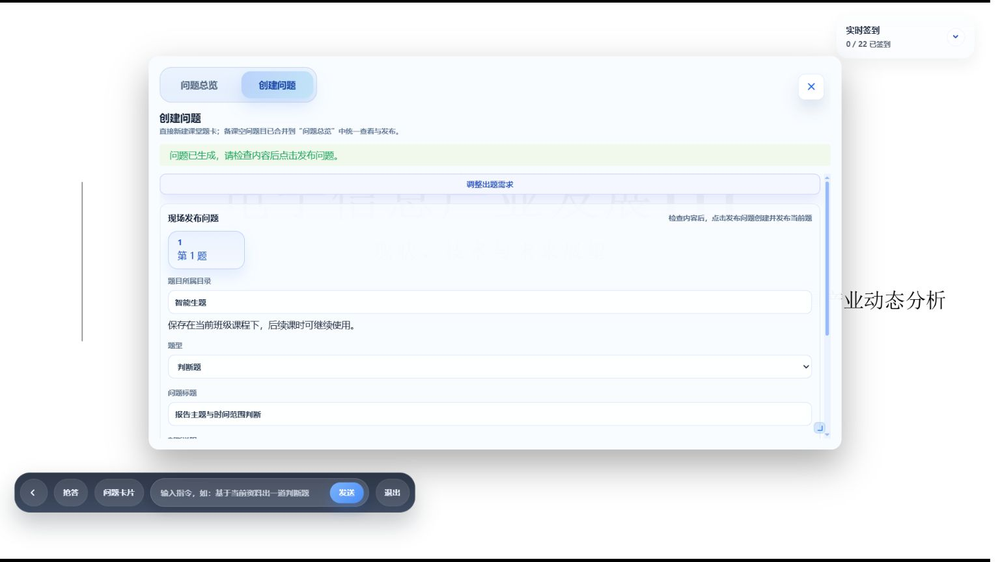
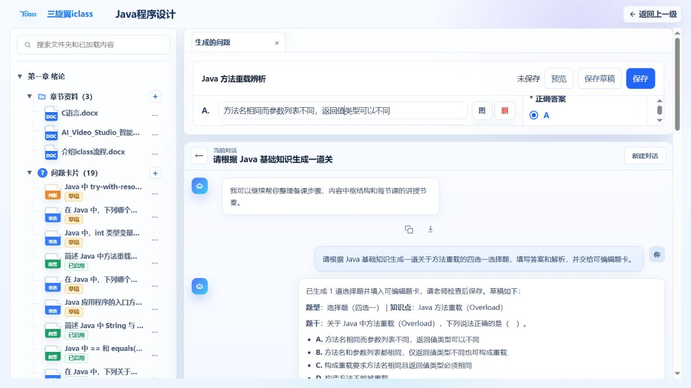
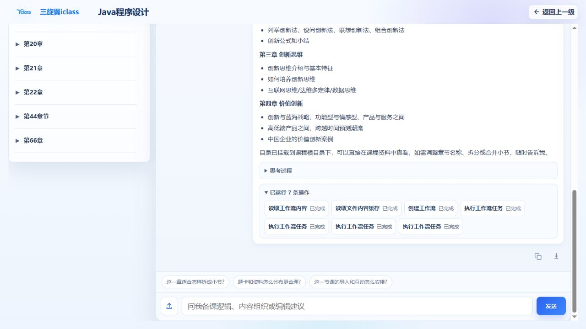
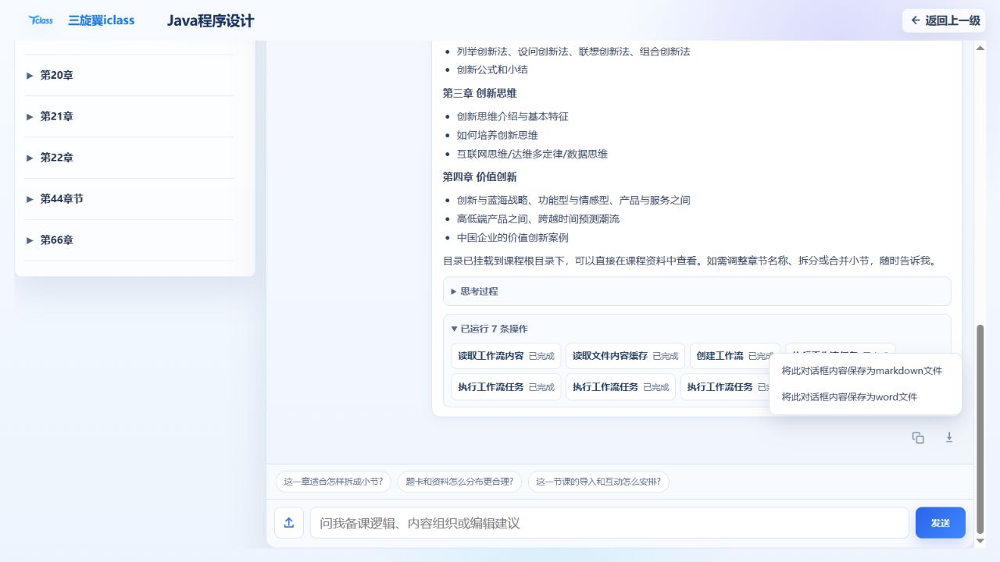

# iClass Agent

**面向教学场景的 Agent 服务与执行框架，连接课件、题卡、教学数据和课堂业务。**

iClass Agent 为教师提供自然语言驱动的备课、授课和教学分析能力：在全屏课件中围绕当前页现场出题，将生成结果交给可编辑题卡，读取课程行为数据生成学情分析与图表，并通过具有依赖关系的多 Agent 工作流执行复杂任务。

本仓库承担 Agent harness 职责；完整交互由 **iclass-web** 提供，教学业务接口与持久化由 **iclass-api** 提供。下文依据实际代码说明能力。本开源副本不包含真实部署地址、运行凭据和业务运行数据。

## 核心功能

### 1. 全屏课件出题：把正在讲授的内容带入对话

教师在全屏授课时，可以通过底部命令栏围绕当前展示页生成问题。课堂助手提供临时对话，题目生成后交给课堂表单，教师检查、编辑后发布。

*Agent 将当前页生成的判断题填入课堂表单；截图展示发布前的编辑环节。*

当前页上下文在**消息发送时采集并绑定到该轮请求**。读取工具返回文件名、实际页码和可提取文字，避免后续翻页改变本轮出题依据。支持 PPT、Word、PDF 当前页的文字读取；尚未识别的图片、图表会明确标记。

实现入口：[当前页读取工具](app/tools/current_display.py)、[页面快照绑定](app/core/display_snapshot.py)、[出题技能](skills/question-builder/SKILL.md)。前端对应 ClassroomPrePresentation.vue、ClassroomPreAssistant.vue 和 useDisplaySnapshot.ts。

### 2. 动态题卡：生成内容直接进入教学表单

Agent 通过 **prepare_classroom_questions** 交付结构化题目，前端将其转换为可编辑题卡。教师可以继续修改题干、选项、答案与解析，在备课页面保存，或在课堂页面发布。

*备课工作台接收本次生成结果，题卡处于“未保存”状态，教师可继续编辑并保存。*

- 结构化交付支持选择题、判断题、简答题，每次 1～10 道。
- 校验题型、选项数量及答案取值，再向前端交付。
- 备课题卡沿用发送时的科目与目录上下文，缺少目录时由教师选择。
- 课堂支持单题与批量发布；创建成功后保留题目编号，发布失败重试时复用已创建题目。
- 生成草稿与保存、发布分开，教师通过业务表单完成最终操作。

~~~text
教师描述需求
  → Agent 读取相关上下文并生成题目
  → prepare_classroom_questions 校验结构
  → 前端接收 assistant_payload 并填入题卡
  → 教师编辑
  → Java 接口保存题目 / 发布课堂问题
~~~

实现入口：[题目交付与校验](app/tools/classroom_questions.py)。前端对应 usePrepGeneratedQuestions.ts、useClassroomQuestionPublishing.ts 和 classroomQuestionDraftApi.ts。

### 3. 学情分析与可视化：从业务记录到可阅读的结果

教师可以针对当前课程或学生发起分析。Agent 读取教学业务数据，生成文字解释、数字面板、图表和数据表格，帮助教师查看出勤、作业提交与课堂参与情况。

| 数据维度 | 后端提供的记录 |
| --- | --- |
| 出勤 | 签到、迟到、请假、缺勤 |
| 课堂答题 | 作答次数、应答题数、正确次数 |
| 作业 | 提交次数、作业总数、平均成绩 |
| 课堂参与 | 抢答、点名、奖励次数和奖励分 |
| 时间与对象 | 班级汇总、学生汇总、每日行为及课时明细 |

数据访问既支持页面业务工具，也支持 **readonly_course_sql_query**。只读 SQL 执行前检查语句、表与字段目录，并由服务端注入当前课程范围。**render_query_result_chart** 与 **render_dashboard_panel** 校验结构化展示数据，前端按协议渲染；图表支持柱状图、折线图、饼图和散点图。

分析由教师请求触发。业务数据查询与可视化由当前请求驱动，不包含后台持续监测或主动预警。

实现入口：[只读查询与展示工具](app/tools/readonly_course_sql.py)、[SQL 校验与课程过滤](app/core/tool/readonly_sql.py)。Java 对应 StudentBehaviorSummaryQueryHandler、StudentBehaviorDailyDetailQueryHandler；前端对应 AssistantSqlChartMessage.vue 与 AssistantDashboardPanelMessage.vue。

### 4. DAG 工作流：让复杂任务按明确契约执行

主 Agent 在常规工具循环中读取工作流、创建运行记录并派发任务。工作流定义来自数据库 **workflow_catalog**，任务按固定 DAG 的依赖关系分批执行。

*已有章节生成工作流的历史执行记录，展示读取工作流、创建运行与多次任务派发；调度机制由下面的运行时代码实现。*

~~~mermaid
flowchart TD
    A[教师请求] --> B[主 Agent 读取工作流]
    B --> C[创建运行记录与定义快照]
    C --> D[选择依赖已完成的任务]
    D --> E[并发执行就绪任务]
    E --> F[独立 Subagent 与限定工具集]
    F --> G[校验结构化输出]
    G -->|成功且仍有任务| D
    G -->|全部完成| H[执行汇总任务]
    G -->|可重试失败| F
    G -->|终止失败| I[取消未完成任务并记录失败]
    H --> J[主 Agent 获取最终汇总]
~~~

| 设计 | 当前实现 |
| --- | --- |
| 定义与状态分离 | 保存工作流定义快照、运行记录和任务结果，执行期间使用该次快照 |
| 依赖调度 | depends_on 决定任务就绪条件，受并发上限控制 |
| 输入边界 | 每个任务接收 global_context、直接依赖的 task_results 与 constants |
| 工具隔离 | 每次任务尝试创建独立 Subagent，只复制 allowed_tools 中的工具 |
| 结构约束 | 使用 JSON Schema 校验任务输入与输出 |
| 失败处理 | 每个任务最多三次尝试；权限拒绝终止执行，终止失败取消未完成任务 |
| 汇总边界 | 汇总任务在所有非汇总任务完成后执行；派发结果向主 Agent 返回最终汇总 |
| 执行反馈 | workflow_status 携带任务名称、状态、尝试次数等信息 |
| 取消与清理 | 支持取消运行；SSE 连接关闭时清理当前运行；启动时将未结束的旧运行标为失败 |

协调工具为 read_workflow_content、create_workflow_run、dispatch_workflow_batch_and_wait、get_workflow_run、cancel_workflow_run。会话、用户与 Agent 身份由运行时注入。

实现入口：[工作流契约](docs/codex-harness/modules/workflow-runtime.md)、[定义模型](app/core/workflow/models.py)、[调度器](app/core/workflow/scheduler.py)、[Subagent 执行器](app/core/workflow/subagent_runtime.py)、[协调工具](app/tools/workflow_tools.py)。

## 补充能力

### 课堂与作业 AI 批改

已开启 AI 评阅的课堂简答题在作答后调度批改；教师也可以对作业发起异步批改，支持文本与可解析的提交附件。Agent 返回分数、判定与评语，Java 负责调度及写回，并在写回前检查提交内容和批改状态。

实现入口：[结构化评分接口](app/api/v1/grading.py)。Java 对应 AiGradingService 与 HomeworkAiReviewStartHandler。

### 分析结果与回复导出

前端支持将助手回复导出为 Markdown 或 Word，并将数字面板导出为 HTML，便于整理教学分析材料。

前端实现入口：assistantMessageExport.ts、assistantDashboardExport.ts 与 AssistantMessageExportMenu.vue。

## 三部分如何协作

~~~mermaid
flowchart LR
    W[iclass-web 页面上下文、题卡、图表、确认交互] <-->|HTTP / SSE| A[iclass-agent 会话、模型循环、工具、工作流]
    A <-->|OpenAPI 工具 / 业务请求| J[iclass-api 教学业务、鉴权、持久化]
    A <--> L[LLM]
    A <--> R[知识检索与文件处理]
    W <-->|业务 API| J
~~~

| 项目 | 职责 |
| --- | --- |
| iclass-web | 教师与学生交互界面；采集课程、学生、目录和展示页上下文；渲染题卡、面板与执行状态 |
| iclass-agent | 构建模型上下文，执行工具循环与工作流，提供权限交互、知识检索和结构化结果 |
| iclass-api | 提供教学业务契约、身份与课程访问检查，以及业务记录写入 |

**按页面装配能力。** 前端传入 current_workflow_page 等运行上下文；Agent 按页面目录加载提示词、工具与工作流。Java 工具结合 SpringDoc/OpenAPI 与 openapi_tool_mapping_catalog 注册，Python 工具通过 agent_python_tool_catalog 配置页面范围与模块，页面提示词由 agent_page_prompt_catalog 管理。

**操作前权限判断。** 工具执行经过 allow、deny、ask 判断；需要人工确认时，前端通过 permission_asked 事件展示操作内容，教师可对配置允许的字段进行调整。always 授权限制在当前会话范围。实现见 [权限协议](app/core/permission/types.py) 与 [权限服务](app/core/permission/service.py)。

**文字与交互数据分开。** 工具的 content 供模型继续处理；meta.assistant_payload 承载前端需要的题卡或可视化数据。工具结果与 workflow_status、permission_asked 等事件共同组成交互协议。

## 演示视频

### Agent 根据 Skill 进行作业

<video src="https://github.com/user-attachments/assets/c1bcbd01-c25b-4f76-94bb-ccca57fae115"></video>

### Agent 工具调用失败后的重试与回答

<video src="https://github.com/user-attachments/assets/315605b8-394d-459a-ba53-b07f5185cd12"></video>

## 开发入口

~~~text
app/
├── api/                 # HTTP、SSE、WebSocket、评分与资源入口
├── core/
│   ├── agent/           # Agent 循环与上下文管理
│   ├── workflow/        # DAG 定义、调度、Subagent 与持久化
│   ├── tool/            # 工具注册、目录、执行与 SQL 校验
│   ├── permission/      # 人工确认请求与会话授权
│   ├── session/         # 会话与消息历史
│   ├── llm/             # 模型适配与用户级模型服务
│   └── rag/             # 文件入库、检索与授权过滤
└── tools/               # 教学与通用工具实现
skills/                  # 运行时技能说明
docs/                    # 模块契约、设计说明与演示图片
~~~

Python 运行使用项目约定的 conda 环境 **langchain**。将根目录的 [.env.example](.env.example) 复制为本地 `.env`，按 [app/config.py](app/config.py) 填写所需服务配置。Agent 运行依赖数据库目录数据、iClass API 与模型服务，RAG 另有检索、入库依赖，见 [RAG 说明](app/core/rag/README.md)。

### 开源副本的配置边界

本仓库不提供可直接连接原部署的配置。模型服务、数据库、Redis、MinIO、内部 API 的真实地址、账号、密码、令牌和存储桶名称已移除；环境模板只保留字段名。

RAG 的 Elasticsearch 地址、凭据和索引名称须在私有配置中填写。需要自定义 RAG YAML 时，通过现有 `ICLASS_RAG_CONFIG` 指定文件；所有真实值仅保存在部署环境中，不得写回源码或提交至 Git。

原项目的 `.env`、运行数据、日志、评测运行结果和内部部署脚本未纳入本副本。含姓名与成绩的部分演示截图也未公开。公开模型标识、算法默认参数、相对目录及程序接口字段属于代码契约，保留以便理解和运行项目。

开源版本不包含测试用例、LLM 模拟适配器、评测数据及运行脚本，也不提供本机测试身份或原始工具调试接口。业务请求必须使用后端验证的真实登录凭证。

在本仓库根目录执行：

~~~bash
conda activate langchain
python -m pip install -e .
python -m uvicorn app.main:app --host 127.0.0.1 --port 8000
~~~

健康检查：**GET /v1/health**。业务前端需使用有效登录身份，并配置到该 Agent 服务与 Java 服务；静态 Agent 页面不替代完整教学前端。

更完整的模块边界见 [Agent Runtime](docs/codex-harness/modules/agent-runtime.md)、[Tool Runtime](docs/codex-harness/modules/tool-runtime.md)、[Permission Governance](docs/codex-harness/modules/permission-governance.md) 与 [项目指南](docs/iclass-agent-project-guide.md)。

